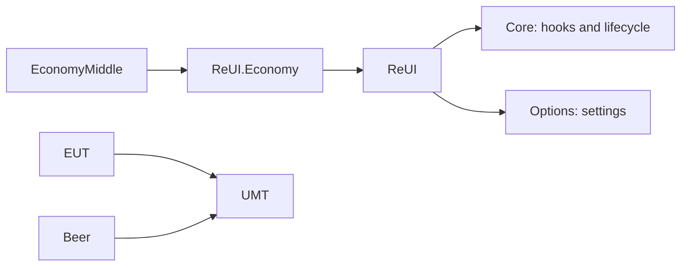

# Dependencies

Review date: 2026-11-10; Claret edges added 2026-11-18. This is not claimed to be a complete survey.

## Claret edges (current)

- ClaretHotbuild -> ClaretCore: Localization, RegisterFeature, RegisterSettingsSection, IsMenuOpen, IsKeyCaptureActive, AppendTransportCargo, CreateStrategicRing; Hotbuild also hooks ClaretCore/modules/MenuKey.lua#Open.\n- ClaretCore -> ReUI (Core, UI, Options); ClaretHotbuild -> ReUI (Core, UI, Options).\n- Rule: Core never imports Hotbuild; the test runner checks this statically.\n- Stored data: ClaretHotbuild (presets v1), ClaretHotbuildContexts (v1–3), ClaretHotbuildKeyboard (v1–2, pairs) plus FAF UserKeyMap, UserKeyDebugKeyMap, UserKeyActions, keyDescriptions as the engine mirror.

Fact: the table below lists version constraints found in readable code. This is not a complete graph: optional checks, strings in comments, and dependencies inside bytecode need manual review. Arrows in the diagram indicate use, not load order.

Diagram sources: EconomyMiddle/mod_info.lua (description), ReUI.Economy/Main.lua, EUT/modules/mexmanager.lua, Beer/modules/mexes.lua; ReUI/Core/Core.lua and ReUI/Options/Options.lua from a separate source copy. The diagram is provisional.

| Consumer mod | Constraint found | File |
|---|---|---|
| ACUEnhancements | ReUI.ActionsPanel >= 1.1.0 | Context/sources/MainMods/ACUEnhancements/ACUEnhancements.lua |
| ACUEnhancements | ReUI.LINQ >= 1.4.0 | Context/sources/MainMods/ACUEnhancements/ACUEnhancements.lua |
| ACUEnhancements | ReUI.UI.Views.Grid >= 1.0.0 | Context/sources/MainMods/ACUEnhancements/ACUEnhancements.lua |
| ACUEnhancements | ReUI.Units.Enhancements >= 1.1.0 | Context/sources/MainMods/ACUEnhancements/ACUEnhancements.lua |
| AKA | ReUI.Actions >= 1.3.0 | Context/sources/MainMods/AKA/Main.lua |
| AKA | ReUI.Construction >= 1.2.0 | Context/sources/MainMods/AKA/Main.lua |
| AKA | ReUI.Core >= 1.0.0 | Context/sources/MainMods/AKA/Main.lua |
| AKA | ReUI.Hotbuild >= 1.1.0 | Context/sources/MainMods/AKA/Main.lua |
| AKA | ReUI.LINQ >= 1.1.0 | Context/sources/MainMods/AKA/Main.lua |
| Bi4UI.StrategicRings | ReUI.Options >= 1.0.0 | Context/sources/MainMods/Bi4UI.StrategicRings/Main.lua |
| Ctrl | ReUI.Actions >= 1.2.0 | Context/sources/MainMods/Ctrl/Main.lua |
| Ctrl | ReUI.Core >= 1.0.0 | Context/sources/MainMods/Ctrl/Main.lua |
| Ctrl | ReUI.LINQ >= 1.0.0 | Context/sources/MainMods/Ctrl/Main.lua |
| Ctrl | ReUI.Options >= 1.0.0 | Context/sources/MainMods/Ctrl/Main.lua |
| DelisRedundantEcoHelp | ReUI.Core >= 1.7.0 | Context/sources/MainMods/DelisRedundantEcoHelp/Main.lua |
| DelisRedundantEcoHelp | ReUI.Options >= 2.0.0 | Context/sources/MainMods/DelisRedundantEcoHelp/Main.lua |
| DynamicSelectionInfo | ReUI.Core >= 1.1.0 | Context/sources/MainMods/DynamicSelectionInfo/Main.lua |
| DynamicSelectionInfo | ReUI.Options >= 1.0.0 | Context/sources/MainMods/DynamicSelectionInfo/Main.lua |
| GS | ReUI.Actions >= 1.0.0 | Context/sources/MainMods/GS/Main.lua |
| GS | ReUI.Core >= 1.0.0 | Context/sources/MainMods/GS/Main.lua |
| Mouse | ReUI.Options >= 1.0.0 | Context/sources/MainMods/Mouse/Main.lua |
| ReUI | ReUI.Core = 1.0.0 | Context/sources/MainMods/ReUI/ModuleMeta.lua |
| ReUI | ReUI.Core >= 0.0.1 | Context/sources/MainMods/ReUI/ModuleMeta.lua |
| ReUI | ReUI.Core >= 1.2.0 | Context/sources/MainMods/ReUI/UI/QoL/Main.lua |
| ReUI | ReUI.Core >= 1.7.0 | Context/sources/MainMods/ReUI/Main.lua |
| ReUI | ReUI.Functional == 0.2.0 | Context/sources/MainMods/ReUI/ModuleMeta.lua |
| ReUI | ReUI.LINQ >= 1.0.0 | Context/sources/MainMods/ReUI/ModuleMeta.lua |
| ReUI | ReUI.Options >= 1.2.0 | Context/sources/MainMods/ReUI/UI/QoL/Main.lua |
| ReUI | ReUI.UI >= 1.4.0 | Context/sources/MainMods/ReUI/UI/QoL/Main.lua |
| ReUI | ReUI.UI.QoL >= 1.0.0 | Context/sources/MainMods/ReUI/Main.lua |
| ReUI.ActionsPanel | ReUI.ActionsPanel = 1.1.3 | Context/sources/MainMods/ReUI.ActionsPanel/mod_info.lua |
| ReUI.Construction | ReUI.Actions >= 1.3.0 | Context/sources/MainMods/ReUI.Construction/Construction.lua |
| ReUI.Construction | ReUI.Construction = 1.3.0 | Context/sources/MainMods/ReUI.Construction/mod_info.lua |
| ReUI.Construction | ReUI.Core >= 1.5.0 | Context/sources/MainMods/ReUI.Construction/Construction.lua |
| ReUI.Construction | ReUI.LINQ >= 1.4.0 | Context/sources/MainMods/ReUI.Construction/Construction.lua |
| ReUI.Construction | ReUI.Options >= 1.2.0 | Context/sources/MainMods/ReUI.Construction/Construction.lua |
| ReUI.Construction | ReUI.UI >= 1.4.0 | Context/sources/MainMods/ReUI.Construction/Construction.lua |
| ReUI.Construction | ReUI.UI.Animation >= 1.1.0 | Context/sources/MainMods/ReUI.Construction/Construction.lua |
| ReUI.Construction | ReUI.UI.Color >= 1.0.0 | Context/sources/MainMods/ReUI.Construction/Construction.lua |
| ReUI.Construction | ReUI.UI.Controls >= 1.0.0 | Context/sources/MainMods/ReUI.Construction/Construction.lua |
| ReUI.Construction | ReUI.UI.Views >= 1.2.0 | Context/sources/MainMods/ReUI.Construction/Construction.lua |
| ReUI.Construction | ReUI.UI.Views.Grid >= 1.1.0 | Context/sources/MainMods/ReUI.Construction/Construction.lua |
| ReUI.Construction | ReUI.Units >= 1.0.0 | Context/sources/MainMods/ReUI.Construction/Construction.lua |
| ReUI.Construction | ReUI.Units.Enhancements >= 1.2.0 | Context/sources/MainMods/ReUI.Construction/Construction.lua |
| ReUI.Construction.Templates | ReUI.Construction.Templates = 1.0.0 | Context/sources/MainMods/ReUI.Construction.Templates/mod_info.lua |
| ReUI.Economy | ReUI.Economy = 1.2.0 | Context/sources/MainMods/ReUI.Economy/mod_info.lua |
| ReUI.Hotbuild | ReUI.Actions >= 1.3.0 | Context/sources/MainMods/ReUI.Hotbuild/Hotbuild.lua |
| ReUI.Hotbuild | ReUI.Core >= 1.2.0 | Context/sources/MainMods/ReUI.Hotbuild/Hotbuild.lua |
| ReUI.Hotbuild | ReUI.Hotbuild = 1.1.0 | Context/sources/MainMods/ReUI.Hotbuild/mod_info.lua |
| ReUI.Hotbuild | ReUI.LINQ >= 1.4.0 | Context/sources/MainMods/ReUI.Hotbuild/Hotbuild.lua |
| ReUI.Hotbuild | ReUI.Options >= 1.0.0 | Context/sources/MainMods/ReUI.Hotbuild/Hotbuild.lua |
| ReUI.Hotbuild | ReUI.UI >= 1.4.0 | Context/sources/MainMods/ReUI.Hotbuild/Hotbuild.lua |
| ReUI.Hotbuild | ReUI.UI.Animation >= 1.0.0 | Context/sources/MainMods/ReUI.Hotbuild/Hotbuild.lua |
| ReUI.Hotbuild | ReUI.UI.Controls >= 1.0.0 | Context/sources/MainMods/ReUI.Hotbuild/Hotbuild.lua |
| ReUI.Hotbuild | ReUI.UI.Views >= 1.2.0 | Context/sources/MainMods/ReUI.Hotbuild/Hotbuild.lua |
| ReUI.Hotbuild | ReUI.UI.Views.Grid >= 1.0.0 | Context/sources/MainMods/ReUI.Hotbuild/Hotbuild.lua |
| ReUI.MissilePanel | ReUI.ActionsPanel >= 1.1.0 | Context/sources/MainMods/ReUI.MissilePanel/Main.lua |
| ReUI.MissilePanel | ReUI.Core >= 1.1.0 | Context/sources/MainMods/ReUI.MissilePanel/Main.lua |
| ReUI.MissilePanel | ReUI.MissilePanel = 1.0.0 | Context/sources/MainMods/ReUI.MissilePanel/mod_info.lua |
| ReUI.MissilePanel | ReUI.Options >= 1.0.0 | Context/sources/MainMods/ReUI.MissilePanel/Main.lua |
| ReUI.MissilePanel | ReUI.UI.Views.Grid >= 1.0.0 | Context/sources/MainMods/ReUI.MissilePanel/Main.lua |
| ReUI.Reclaim | ReUI.Core >= 1.3.0 | Context/sources/MainMods/ReUI.Reclaim/Reclaim.lua |
| ReUI.Reclaim | ReUI.Options >= 1.0.0 | Context/sources/MainMods/ReUI.Reclaim/Reclaim.lua |
| ReUI.Reclaim | ReUI.Reclaim = 1.2.1 | Context/sources/MainMods/ReUI.Reclaim/mod_info.lua |
| ReUI.Reclaim | ReUI.UI >= 1.4.0 | Context/sources/MainMods/ReUI.Reclaim/Reclaim.lua |
| ReUI.Reclaim | ReUI.WorldView >= 1.0.0 | Context/sources/MainMods/ReUI.Reclaim/Reclaim.lua |
| ReUI.Score | ReUI.Score = 1.2.4 | Context/sources/MainMods/ReUI.Score/mod_info.lua |
| SplitGroupScatter | ReUI.Actions >= 1.0.0 | Context/sources/MainMods/SplitGroupScatter/Main.lua |
| SplitGroupScatter | ReUI.Core >= 1.0.0 | Context/sources/MainMods/SplitGroupScatter/Main.lua |
| TeamMouse | ReUI.Options >= 2.0.0 | Context/sources/MainMods/TeamMouse/Main.lua |

## `gamemain.lua` Hooks
Confirmed: 14 files found. The number of hooks alone does not prove a conflict.
- `Context/sources/MainMods/ASE/hook/lua/ui/game/gamemain.lua`
- `Context/sources/MainMods/Beer/hook/lua/ui/game/gamemain.lua`
- `Context/sources/MainMods/Bi4UI.StrategicRings/hook/lua/ui/game/gamemain.lua`
- `Context/sources/MainMods/BindStorage/hook/lua/ui/game/gamemain.lua`
- `Context/sources/MainMods/BuilderAltSelect/hook/lua/ui/game/gamemain.lua`
- `Context/sources/MainMods/cinematics/hook/lua/ui/game/gamemain.lua`
- `Context/sources/MainMods/dear-windowing/hook/lua/ui/game/gamemain.lua`
- `Context/sources/MainMods/DelisRedundantEcoHelp/hook/lua/ui/game/gamemain.lua`
- `Context/sources/MainMods/Mouse/hook/lua/ui/game/gamemain.lua`
- `Context/sources/MainMods/Regen Aura Range/hook/lua/ui/game/gamemain.lua`
- `Context/sources/MainMods/ReUI/hook/lua/ui/game/gamemain.lua`
- `Context/sources/MainMods/Reveal positions/hook/lua/ui/game/gamemain.lua`
- `Context/sources/MainMods/TeamMouse/hook/lua/ui/game/gamemain.lua`
- `Context/sources/MainMods/UMT/hook/lua/ui/game/gamemain.lua`
